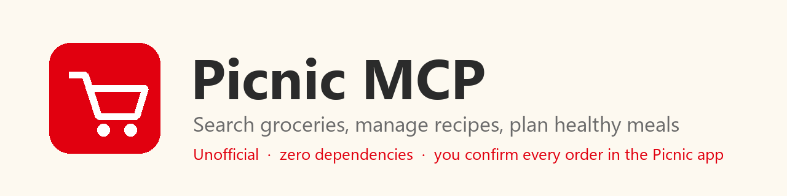

# picnic-mcp

[English](README.md) | **Deutsch** | [Nederlands](README.nl.md) | [Français](README.fr.md)

Ein MCP-Server und Claude-Plugin für [Picnic](https://picnic.app), den Lebensmittel-Lieferdienst. Claude kann das Sortiment durchsuchen, für jede Zutat das passende Produkt auswählen (günstigstes, Bio, bestes Preis-Leistungs-Verhältnis), deinen Warenkorb füllen, Picnic-Rezepte samt Nährwerten lesen und eigene Rezepte in der App speichern. Die Bestellung bestätigst und bezahlst du in der Picnic-App, Claude schließt also nie selbst ab.

Der Server nutzt nur die Python-Standardbibliothek. Es gibt nichts von PyPI zu installieren und keinen Fremdcode, dem du vertrauen musst. Der Picnic-Client, die MCP-Protokollschicht, der Browser-Login und die Speicherung der Zugangsdaten sind komplett in diesem Repository geschrieben.

## Zuerst lesen

Dieses Projekt ist inoffiziell und steht in keiner Verbindung zu Picnic. Picnic hat keine öffentliche API. Die Endpunkte wurden anhand des öffentlichen Quellcodes des gepflegten Projekts `python-picnic-api2` als Vorlage (importiert wird nichts davon) und durch Tests mit einem echten Konto ermittelt. Picnic kann diese API jederzeit ändern oder sperren, und die Nutzung kann gegen die Nutzungsbedingungen verstoßen. Nutze das Projekt nur für dein eigenes Konto und für den privaten Gebrauch.

## Installation

Du brauchst [uv](https://docs.astral.sh/uv/). Beim ersten Start wird Python 3.14 (festgelegt in `.python-version`) heruntergeladen und das Projekt gebaut, das kann einen Moment dauern. Danach startet es in einer Sekunde.

### Als Claude-Plugin

```
/plugin marketplace add jlb-jlb/picnic-mcp
/plugin install picnic-mcp@picnic-mcp-marketplace
```

Claude Code fragt beim Aktivieren des Plugins nach deinem Picnic-Land (`nl`, `de`, `be` oder `fr`). Das Plugin bringt außerdem einen Skill mit, der Claude die Reihenfolge der Werkzeuge erklärt.

### Als einfacher MCP-Server

```bash
git clone https://github.com/jlb-jlb/picnic-mcp
claude mcp add picnic --env PICNIC_COUNTRY=de -- uv run --locked --directory ./picnic-mcp picnic-mcp
```

Nimm den absoluten Pfad zum Klon, wenn dein Client den Server aus einem anderen Ordner startet.

## Anmelden

Bitte Claude, sich bei Picnic anzumelden. Claude ruft das Werkzeug `start_login` auf, das eine Anmeldeseite in deinem Browser öffnet. Dort gibst du E-Mail-Adresse und Passwort ein, wählst SMS oder E-Mail für den Einmalcode und gibst den Code ein. Picnic verlangt diesen zweiten Schritt bei Konten, bei denen er aktiviert ist.

Die Seite läuft auf deinem eigenen Rechner und schließt sich, wenn du fertig bist. Sie sendet deine Angaben nur an Picnic. Claude sieht weder dein Passwort noch den Code. Ohne Claude öffnet sich dieselbe Seite mit `uv run --directory <Pfad zu diesem Repository> picnic-mcp login --web`, und eine reine Terminal-Abfrage gibt es, wenn du `--web` weglässt. Der Befehl `picnic-mcp` allein existiert nur dann im PATH, wenn du das Paket mit `uv tool install` installiert hast.

## Wohin deine Zugangsdaten gehen

| Was | Wohin | Hinweise |
|---|---|---|
| Passwort und Einmalcode | Vom Browser zur lokalen Seite, weiter an Picnic | Nur während des Login-Aufrufs im Arbeitsspeicher. Nie auf die Festplatte geschrieben, nie protokolliert, nie für Claude sichtbar. |
| Sitzungstoken | Der Zugangsdatenspeicher des Betriebssystems | Windows-Anmeldeinformationsverwaltung, macOS-Schlüsselbund oder der Linux-Desktop-Schlüsselbund über `secret-tool`. Es gibt keine Ausweichlösung mit einer Datei. |

Ohne Zugangsdatenspeicher schlägt die Anmeldung mit einer Meldung fehl, die sagt, was zu installieren ist. Unter Linux ist das `secret-tool` aus libsecret (`libsecret-tools` bei Debian und Ubuntu) sowie ein laufender Schlüsselbund wie GNOME Keyring. Server ohne Oberfläche und reines WSL haben meist keinen.

Die Anmeldeseite ist eine kurzlebige lokale Webseite mit diesen Schutzmaßnahmen:

- Sie lauscht nur auf `127.0.0.1`, an einem zufälligen Port.
- Die Adresse enthält ein zufälliges Einmalgeheimnis. Jede andere Adresse liefert 404.
- Sie lehnt Anfragen mit einem anderen Hostnamen (DNS-Rebinding) und Formulare von anderen Seiten ab.
- Sie setzt keine Cookies und führt keine Skripte aus, und eine strenge Content-Security-Policy verbietet alles andere.
- Die Anfragegröße ist begrenzt, Fehlversuche sind begrenzt, und die Seite läuft nach fünf Minuten ab.
- Sie protokolliert nichts.

## Daten und Netzwerk

Der Server spricht mit genau einer Stelle, der Picnic-API unter `storefront-prod.<land>.picnicinternational.com`. Er sendet keine Telemetrie und speichert keine Gesprächsinhalte. Warenkorb, Rezepte und Bestellverlauf bleiben bei Picnic. Auf deinem Rechner liegt nur das Sitzungstoken im Zugangsdatenspeicher. Mit `picnic-mcp logout` meldest du dich ab, das löscht das gespeicherte Token für dein Land.

## Werkzeuge

| Werkzeug | Was es macht |
|---|---|
| `start_login` | Öffnet die oben beschriebene lokale Anmeldeseite. |
| `search_products` | Durchsucht das Sortiment. Liefert ID, Name, Preis in Cent, Packungsgröße und Grundpreis. |
| `find_ingredients` | Wählt je Zutat das beste Produkt nach einer Vorgabe (günstigste für die Menge, bester Preis pro kg, Bio, konventionell, kleinste oder größte Packung) und liefert die zu kaufenden Packungen, die Gesamtkosten und den Rest. Rührt den Warenkorb nicht an. |
| `get_cart` | Zeigt die Artikel im Warenkorb und die Summe in Cent. |
| `add_to_cart` | Legt ein Produkt per ID in den Warenkorb (Anzahl 1 bis 50). |
| `remove_from_cart` | Entfernt eine Menge eines Produkts. |
| `clear_cart` | Leert den Warenkorb. |
| `search_recipes` | Durchsucht Picnics Rezepte und deine eigenen. Liefert ID, Name, Dauer und Labels wie Vegan. |
| `get_recipe` | Zeigt ein Rezept mit Zubereitungsschritten, Zutaten samt zugeordnetem Produkt, Mengen und Nährwerten pro Portion. |
| `add_recipe_to_cart` | Legt die Zutaten eines Rezepts in den Warenkorb wie die Alles-hinzufügen-Taste der App, mit Portionen und optionalen Zutaten zum Einschließen oder Weglassen. |
| `remove_recipe_from_cart` | Nimmt die Zutaten eines Rezepts wieder aus dem Warenkorb. |
| `create_recipe` | Speichert ein eigenes Rezept in der Picnic-App („Eigenes Rezept“) aus Name, Portionen und Produkt-IDs der Zutaten. Rührt den Warenkorb nicht an. |
| `delete_recipe` | Löscht ein Rezept, das du mit `create_recipe` angelegt hast. |
| `get_delivery_slots` | Listet buchbare Lieferfenster für den aktuellen Warenkorb, das früheste zuerst. Bucht keines. |
| `get_order_history` | Listet die letzten abgeschlossenen Lieferungen mit Datum, Lieferfenster und bezahltem Betrag. Die Produkte sind nicht enthalten. |

Jedes Werkzeug deklariert einen Titel sowie die Hinweise schreibgeschützt, destruktiv, idempotent und offene Welt, damit Clients vor allem nachfragen können, was Daten entfernt.

Ein Werkzeug zum Abschließen der Bestellung gibt es absichtlich nicht. Der Server füllt den Warenkorb, und du bestätigst die Bestellung in der Picnic-App.

## Beispielanfragen

- „Schlage mir drei gesunde Abendessen für nächste Woche vor, die jeweils unter 30 Minuten dauern und sich Zutaten teilen. Ein Kilo Möhren oder ein Bund Koriander soll also in zwei Rezepten aufgebraucht werden. Prüfe die Nährwerte pro Portion und zeig mir dann eine gemeinsame Einkaufsliste mit den Gesamtkosten, bevor du etwas in den Warenkorb legst.“
- „Ich koche für zwei Personen. Finde bei Picnic die besten Produkte für 400 g Spaghetti, 600 g Möhren, 3 Eier, 200 g Feta und einen Bund Petersilie. Nimm Bio beim Gemüse und das günstigste Produkt bei allem anderen, und zeig mir die Packungen, die Summe und den Rest.“
- „Finde ein veganes Linsenrezept unter 30 Minuten mit mindestens 20 g Eiweiß pro Portion, leg es für zwei Personen in den Warenkorb und sag mir, welche Lieferfenster am Freitagabend frei sind.“
- „Plane fünf schnelle Mittagessen, die ich sonntags für die Arbeitswoche vorkochen kann, vegetarisch und eiweißreich, mit möglichst wenigen verschiedenen Zutaten. Such bei Picnic nach Rezeptideen und zeig die Kosten pro Portion.“
- „Speichere meine Linsensuppe als Picnic-Rezept für vier Portionen mit diesen Zutaten, damit ich sie in der App mit einem Tipp in den Warenkorb legen kann.“

## Gut zu wissen

- Picnic verkauft ganze Packungen. Ein selbst angelegtes Rezept enthält Produkte und Packungsanzahlen, nicht „3 Karotten“, und die App bietet für eigene Rezepte keinen Platz für Zubereitungsschritte oder einen Bereich „zu Hause vorhanden“. Bewahre die in deinen Notizen auf.
- Bio wird am Produktnamen erkannt (Bio, Bioland, Demeter, Naturland), weil die Suchergebnisse kein Bio-Kennzeichen enthalten.
- `find_ingredients` markiert ein Ergebnis als lose, wenn kein Produktname alle Wörter der Anfrage enthält.
- Die Nährwerte stammen aus Picnics eigenen Rezepten und sind Schätzwerte.

## Fehlersuche

| Problem | Was zu tun ist |
|---|---|
| „no stored session“ | Bitte Claude um die Anmeldung oder führe `uv run --directory <Pfad zu diesem Repository> picnic-mcp login --web` aus. |
| Anmeldung scheitert direkt nach dem Code | Prüfe, ob die Ländereinstellung zu deinem Konto passt. Codes laufen schnell ab. |
| „no desktop keyring found“ (Linux) | Installiere `libsecret-tools` und einen Schlüsselbund wie `gnome-keyring` und arbeite in einer Desktop-Sitzung. |
| HTTP 403 bei jedem Aufruf | Das Sitzungstoken ist abgelaufen. Melde dich neu an. |
| Der erste Start ist langsam | uv lädt Python herunter und baut das Projekt. Spätere Starts sind schnell. |
| Umlaute sehen kaputt aus | Aktualisiere auf die aktuelle Version, die unter Windows UTF-8 liest und schreibt. |

## Entwicklung

```bash
uv run python -m unittest discover -s tests
```

Die Tests laufen offline gegen eine nachgebildete Netzwerkschicht. Die Continuous Integration führt sie unter Windows, macOS und Linux aus und testet zusätzlich einen echten Durchlauf gegen den Zugangsdatenspeicher des jeweiligen Systems.

Veröffentlichen: Erhöhe die Version in `pyproject.toml`, `.claude-plugin/plugin.json` und `src/picnic_mcp/server.py`, führe `uv lock` aus und setze `ref` und `version` des Plugin-Eintrags in `.claude-plugin/marketplace.json` auf das neue Tag. Committe, und pushe dann ein Tag wie `v0.3.0`. Der Release-Workflow prüft, ob das Tag zu den Versionen passt, führt die Tests aus und veröffentlicht das GitHub-Release. Plugin-Installationen folgen dem Tag aus der Marketplace-Datei und nicht `main`.

Aufbau:

- `src/picnic_mcp/client.py`: HTTP-Client (`urllib`), Anmeldung, Suche, Warenkorb, Rezepte, Lieferungen sowie Hilfen, die Antworten für das Modell verkürzen.
- `src/picnic_mcp/finder.py`: die Zutatensuche (Packungsgrößen lesen, Bio erkennen, Rangfolge).
- `src/picnic_mcp/auth.py`, `weblogin.py`, `secretstore.py`: Anmeldung, die Browser-Anmeldeseite und die Speicher für Zugangsdaten.
- `src/picnic_mcp/server.py`: JSON-RPC 2.0 über stdio, Werkzeugregister, Annotationen und Argumentprüfung.
- `.claude-plugin/` und `skills/`: das Plugin-Manifest, die Marketplace-Datei und der Einkaufs-Skill.
- `tests/`: Offline-Tests.

## Ideen für später

- Nährwert-Abfrage über Open Food Facts für gesunde Essensplanung.
- Ein MCP-Prompt `plan_week`, der Ernährungsziele und Vorlieben in einen Warenkorb übersetzt.

## Lizenz

MIT, siehe [LICENSE](LICENSE).
